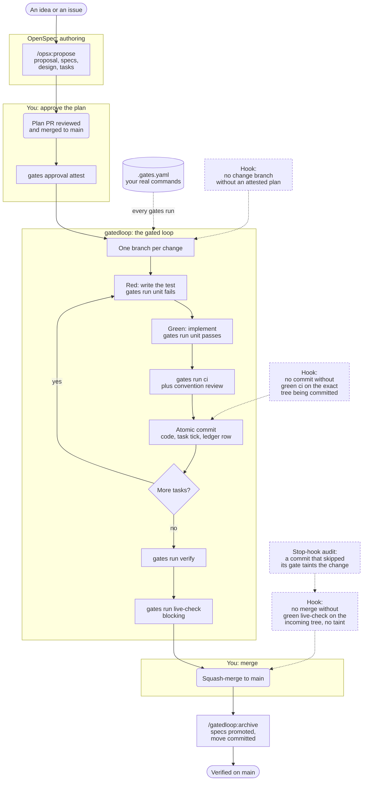

# gatedloop

**Status.** Built for the author's own projects, and it works there. It is 0.x, so it changes without notice. It is tested against OpenSpec 1.14.3. No support is promised: one maintainer has run the loop so far, and [`docs/status.md`](./docs/status.md) says what has been exercised and where it is fragile. It is for people already running unattended coding agents who have been burned by "the agent said it ran the tests". Issues are welcome: run `/gatedloop:feedback`, or open a GitHub issue.

Issue numbers before 0.7.0 were remapped when the issues moved here from the private archive repository. PR references in the history and the changelog name that archive, not this repository.

## What it does

gatedloop covers one stretch of the software lifecycle: **from a plan a person has approved to a merge a person decides on.** Inside that stretch a coding agent implements, tests and integrates on its own. gatedloop's job is to make sure the agent cannot leave that loop without a human: it cannot start on an unapproved plan, cannot commit past a red gate, cannot edit the tests it is held to, cannot retry forever, cannot stop quietly, and cannot merge where your process says a person merges. Each of those is a hook that denies the action, not a sentence in a prompt. A gate is a command your project declares, and its verdict is the exit code, nothing else.

It does not write the plan, and it does not deploy. [OpenSpec](https://github.com/Fission-AI/OpenSpec) authors the plan; your pipeline ships the result. gatedloop is the enforcement and onboarding layer between the two.

### Where it sits in the lifecycle

| Stage | Who does it | gatedloop's part |
|---|---|---|
| Intent, requirements, design | You, with OpenSpec (`/opsx:propose`) | None. It neither authors nor judges the plan. `/gatedloop:propose` only opens the pull request you review it in. |
| **Plan approval** | A person, in the plan PR | Records the approval and pins it to the plan's content. Implementation cannot start without it, or after the plan is edited. |
| **Implementation and testing** | The agent | The loop: tests written and locked first, then red, green, `ci`, convention review, one atomic commit per task. |
| **Integration** | gatedloop, then a person | Proves the branch head, publishes the evidence, opens the PR or squashes. Stops wherever your declared process needs a person. |
| **Merge decision** | A person | The agent cannot supply it. |
| Deploy, operate, monitor | Your pipeline | None. |

### What the agent cannot do

Every row is a `PreToolUse` or `Stop` hook, or a check inside `gates`, that denies the action outright. SETUP.md's "Enforcement" section has the mechanism behind each one.

| The agent cannot... | ...without | Enforced by |
|---|---|---|
| start implementing a change | a plan a person approved, unchanged since the approval | the branch-creation hook (`gates discipline check-implement`) |
| commit | a green `ci` on exactly the tree being committed | the commit hook, and the optional git `pre-commit` hook |
| edit a test it is implementing against | sending it back as a defect | the authored-test lock, checked at every commit and again at the merge |
| keep retrying a red task | a person | the retry budget: past `loop.attempts`, `gates run` refuses the task's next run |
| stop early, or narrate a halt instead of recording it | a `halt` row with a cause from a closed set | the `Stop` hook, which re-enters the loop at the next unchecked task |
| merge | a green `live-check` on the incoming tree, and no commit that skipped its gate | the merge hook, and `gates merge` step 1 |
| merge at all, where your process names a person | your review | `integration.requireApproval`; in pull-request mode the forge's branch protection, which the agent cannot satisfy |
| archive | the change present on the merge target | the archive hook |

A task is done exactly when its code, its checkbox and its ledger row are committed together, so a halted run resumes from the first unchecked task, and the ledger is the record of every gate verdict along the way.

## Quickstart

You need Claude Code, the OpenSpec CLI (tested at 1.14.3), Python 3.9+, and `gh` for the pull-request steps. In Claude Code:

```bash
/plugin marketplace add tessellate-space/gatedloop
/plugin install gatedloop
```

Start a new session, because hooks load at session start. Then, in the project you want to use it on:

```bash
openspec init --tools claude    # OpenSpec's openspec/ directory and its /opsx:* commands
/gatedloop:gates-init           # binds your real commands in .gates.yaml; ends only when ci is bound and gates validate passes
```

Then take one small change through the loop:

```bash
/gatedloop:propose add-a-small-thing    # /opsx:propose writes the plan; this opens the plan PR
# review the plan PR and merge it; then, on main:
gates approval attest add-a-small-thing --pr <n>    # records the approval from the PR's approving review; commit what it writes
/gatedloop:tdd-apply add-a-small-thing  # red, green, ci and review, one commit per task; then verify, live-check and the merge
```

Working alone? GitHub won't let you approve your own pull request. Declare `approval: { plan: self }` in `.gates.yaml` and attest with `--merged <n>` instead (SETUP.md, "The declared approval policy"). `tdd-apply` stops before the merge wherever your declared process needs a person; `/gatedloop:merge` does it when you're ready.

[`docs/topology.md`](./docs/topology.md) shows how the maintainer runs several of these at once: planner sessions, implementers in Claude Code on the web, and one merge lane.

## How it fits together

gatedloop closes the loop from an approved [OpenSpec](https://github.com/Fission-AI/OpenSpec) change to verified-on-main — gated per-task TDD, convention review, a blocking live self-check, a squash-merge — and gets a project onto that loop in the first place. It does not decide what a change produces or in what order; that is OpenSpec's job, through a workflow schema, upstream.

Three owners, one loop:

| Owner | Owns |
|---|---|
| **Upstream (OpenSpec)** | Authoring — proposal, specs, design, tasks — and *which* artifacts a change produces at all (the schema). |
| **Your project** | The stack — gate commands, surfaces, conventions prose — bound once in `.gates.yaml`. |
| **gatedloop** | The loop between them: gated TDD per task, convention review, live self-check, squash-merge — plus getting a project onto it (onboarding). |

This README states the boundary. The reasoning behind it (the two-axis model, the two gate families, and the adoption-ladder scoring) is recorded in the archived design of `reposition-specloop`, under `openspec/changes/archive/`.

Two projects, one workflow, and the seam is deliberate — **OpenSpec authors the artifacts, gatedloop runs the gated loop over them**:



How to read it:

- **Three owners.** OpenSpec authors the plan. gatedloop runs the loop, interactively with `/gatedloop:tdd-apply` or unattended with the `tdd-implementer` agent. Your `.gates.yaml` supplies every real command, so gatedloop never names your stack.
- **Two human decisions.** You approve the plan before any code is written, and you merge the result. Everything between them runs without a human turn.
- **Solid arrows are the path; dashed arrows are enforcement.** Each gate is a hook that denies the action outright, not a sentence in a prompt. A commit needs a green `ci` on exactly the tree being committed (a commit of only ledger rows or only planning files is checked at its own lighter grade instead, by the same check whether it arrives through the tool hook or the optional git `pre-commit` hook). A merge needs a green `live-check` on exactly the tree coming in.
- **Resumable at every task boundary.** A task is done only when its code, its checkbox and its ledger row are committed together, so a halted run restarts from the first unchecked task.
- **A stopping rule in code.** After a task's RED run, it gets `loop.attempts` failed `unit` or `ci` runs (default 2), counted from the ledger. After each one the loop writes a four-line `gates attempt note`. Past the budget, `gates run` refuses that task's next run. The dispatcher may then restart the task once in a fresh context that reads only the notes (`loop.fresh-restarts`, default 1, via `gates attempt restart`) before a human gets it.

gatedloop ships no copy of the OpenSpec commands. Those commands are installed and kept current by OpenSpec itself, so they improve without us mirroring them — and when something breaks, the namespace tells you which project to file it against.

## What you get

gatedloop owns exactly two surfaces — getting a project onto the loop, and running it — and gives both equal billing, not one as an apology for the other.

**Getting onboard:**

| Piece | What it does |
|---|---|
| `/gatedloop:gates-init` | Onboards the current project: detects your task runner, proposes gates + surfaces, generates the conventions source, and doesn't finish until `ci` is bound and `gates validate` passes. |
| `/gatedloop:start` + SessionStart hook | Greets each session with a tailored menu grounded in live OpenSpec/git state — including "you haven't onboarded yet" when that's true. |
| `/gatedloop:upgrade` | After a plugin update, asks one question for each new setting this project hasn't decided on yet, recommended answer first, and records each answer in `.gatedloop/adoption.json`. The session brief says when anything is waiting. |
| `workflow-select` skill | Browse and install OpenSpec workflow schemas — the bundled default, the community catalog, or gatedloop's own `bugfix`/`architecture` packs — reachable at any time, not only at onboarding. |

**Running the loop:**

| Piece | What it does |
|---|---|
| `/gatedloop:propose` | Authors a change through `/opsx:propose`, then adds the one step upstream leaves out: the branch, the commit and the pull request a human reviews the plan in. Implementation can't start until that plan is merged and approved. |
| Plan approval | `gates approval attest <change>` writes the approval keys from the plan PR's `APPROVED` review (`--pr <n>`), or, under `approval.plan: self`, from the merge of the plan PR (`--merged <n>`: the forge's merger and merge time) or machine-side (`--local`). In pull-request mode under `self`, `gates record-merged` attests a merged `plan/<change>` PR itself. `gates handoff <change> [--json]` prints the payload a planner session sends the orchestrator, only once the plan is approved on the merge target. |
| `/gatedloop:tdd-apply` | The loop: branch-per-change, red→green→gate→atomic-commit per task, then verify + live self-check + squash-merge. |
| `/gatedloop:archive` | Delegates to `/opsx:archive`, then **commits the move** — upstream leaves it in the working tree, and a loop that ends "verified on main" cannot end dirty. |
| `/gatedloop:merge` | Integrates a finished change for a person: shows the acceptance brief, asks once, runs `gates merge <change>` and reports the step it ended on. `gates merge` does the whole `local-squash-merge` in code — prove the head, squash onto the target's tip, an unscoped `ci` on the merged tree, the merge row, the optional `confirm` gate, archive — and pushes once, only after every step passed. Under `integration.mode: pull-request` it proves the head the same way, pushes the branch, publishes its markers as `gatedloop/*` commit statuses (`gates marker publish`; `gates marker check-remote` verifies one) and opens or updates the PR with the brief as its body, enabling squash auto-merge only where nothing the declared process names stands in the way. After the forge merges it, `gates record-merged <sha>` records the merge and archives the change in one local commit. |
| `test-author` agent | Writes every task's failing tests for a change before any of it is implemented (Sonnet), from the specs, the design, public interfaces and your `tests` rules — never from the implementation. Dispatched once per change by whoever dispatches the implementer; its tests are locked, so the implementer can only make them pass or send one back as a defect. The lock is checked at every commit by the commit hooks, verified again at the merge (`gates merge` step 1 runs `gates tests check --ref` on the head) and at the forge (`gates marker publish tests` posts a `gatedloop/tests` status branch protection can require). |
| `tdd-implementer` agent | Runs the whole loop autonomously (Sonnet), resumable, halts-and-reports on ambiguity, **stops before the merge**. |
| `merge-runner` agent | The merge for an orchestrator (Sonnet): runs `gates merge <change>` and routes on its exit code; in pull-request mode a PR handed off to the forge is success. On a local squash conflict it syncs the target into the change branch, resolves only a mechanical conflict (both sides added list entries, reordered imports), re-runs the head's gates and retries once; anything that needs a choice between two behaviours halts with cause `other`, naming the paths and both sides. |
| `convention-review` agent | Fast read-only gate: checks a diff against the rules the change's surfaces select, plus the built-in `gatedloop.test-quality` rule (`rules/loop-rules.md`), which holds every test a diff adds or changes to failing for a real regression at the lowest layer that can observe it. |
| `schema-review` agent | `convention-review`'s shape applied to a workflow schema instead of a diff: fit, instruction coherence, and whether `gates schema inspect`'s flagged tool names are real coupling or a passing mention — run automatically the moment a new schema is installed. |
| Epics | A story of several changes: each child names its epic with `x-gatedloop-epic` in its own `.openspec.yaml`, and `gates validate` checks the link. Hooks keep the epic itself from ever being implemented and from being archived before every child is. `gates epics` lists each epic's children with a state derived from the ledger, `gates stats --epic <name>` rolls up their economics, and the session brief shows one line per active epic. |
| `verify` skill | Spec→acceptance coverage + runs your acceptance suite. |
| `gates` shim | Deterministically runs your gates/live-checks and computes which rules/probes apply to a diff, and keeps `openspec/config.yaml`'s artifact rules in sync with your conventions source. |

Alongside, from OpenSpec: `/opsx:explore` (think), `/opsx:propose` (proposal + specs + design + tasks), `/opsx:apply` (walk a task list, ungated — `tdd-apply` is the gated one), `/opsx:sync` (push edited specs back), `/opsx:archive`, plus stores and schemas.

The loop scales to N agents running concurrently in their own `git worktree`, one
serialized merge lane in the primary checkout — see
[`docs/worktree-lanes.md`](./docs/worktree-lanes.md) for the topology, what's
per-worktree vs repo-wide, and the two optional manifest knobs it adds (`discipline`, `concurrency`).
A serialized gate's wait for another lane's lock is bounded by `concurrency.max-wait-seconds`
(default 480, below the host's 600 s tool-call cap); past it the run exits 75 with
`gatedloop: lock busy` and the loop simply re-runs it. `gates lock status` shows who
holds each lock, for how long, and whether that holder looks hung; nothing in gatedloop
ever kills one. [`docs/running-at-scale.md`](./docs/running-at-scale.md) is a worked
example of building an orchestrator and a CI workflow from what ships — selection,
authoring, one lane per change, `ready`/`halt` rows, `gates merge` in either mode,
published statuses and `gates record-merged`, planner sessions handing plans to one
orchestrator with `gates handoff` — an example to adapt, not a supported component.

## Where gatedloop sits on the adoption ladder

An existing OpenSpec adoption model scores each SDLC phase 0–4 — `none` → `advise` → `observe` → `act` → **`close`**, where *close* means a tool changes real state, reads back the result, and self-corrects with no human turn — across three levels:

| Level | What the team adds | What moves |
|---|---|---|
| **Rookie** | `openspec init`, run the default loop | System design, Implementation → `act` |
| **Intermediate** | fork a schema, write the constitution, add skills | Testing → `act`, Code review → `observe` |
| **Advanced** | subagents running unattended, hook-enforced gates, oracles | Implementation, Testing, Code review, Release → **`close`** |

**gatedloop is the advanced rung, prefabricated.** That model's own answer to "how do I get a gate?" is that the gate only exists because a team builds one — gatedloop ships the pieces that answer requires:

| Advanced level needs | gatedloop ships |
|---|---|
| A subagent that runs the recipe unattended | `tdd-implementer` agent |
| A **gate** — a required checkpoint a change must pass | `.gates.yaml`, abstract gate names |
| An **oracle** — the machine-readable verdict a gate reads back, not a human's memory of having checked | the exit code, and only the exit code |
| A **hook** — what makes the gate non-optional | `PreToolUse`/`Stop` hooks — `hooks/hooks.json` |
| Code review → `close` | `convention-review`, surfaces, rule-ids |
| Release → `close` | `live-check`, blocking |

The two jobs gatedloop owns, restated on the ladder: **climb** — get a team from rookie to advanced without building the machinery themselves (onboarding, `gates-init`) — and **close** — supply the gate, oracle, and hook that turn `act` into `close` (the loop, the subagents, enforcement).

**The limit, stated where the claim is:** Requirements never moves on this scale — nothing here gives "is this the right requirement" a machine-readable verdict. System design reaches `act` and stops, for the same reason. gatedloop closes **four** phases — Implementation, Testing, Code review, Release — not six.

This ladder scores *SDLC phases*, not the organisation.


## Install

The quickstart above is the whole install. `openspec init` on its own gives you the CLI but no authoring commands, so `gates-init` checks for `.claude/commands/opsx/` and offers to fix it.

### Migrating from an earlier gatedloop

| Was | Now |
|---|---|
| `/gatedloop:explore` | `/opsx:explore` |
| `/gatedloop:propose` | `/gatedloop:propose` — same name; authoring is now `/opsx:propose`'s, and this command adds the plan PR |
| `/gatedloop:archive` | `/gatedloop:archive` — same name, now a thin delegation to `/opsx:archive` plus the commit |
| `/gatedloop:harness-init` | `/gatedloop:gates-init` |
| `.harness.yaml`, `harnessVersion` | `.gates.yaml`, `gatesVersion` |
| `harness` (the `bin/` shim) | `gates` |

Run `openspec init --tools claude` once if you don't already have the `/opsx:` commands. The upstream versions are *newer* than the copies they replace: they support `--store`, resolve paths from the CLI rather than assuming `openspec/changes/<name>/`, and add `/opsx:sync`, which had no gatedloop equivalent at all.

The `harness`/`.harness.yaml` names no longer work at all: `bin/harness` is gone, and a `.harness.yaml` (or `harnessVersion` key) fails validation like any other malformed manifest. Rename to `gates`/`.gates.yaml`/`gatesVersion` if you haven't already.

### Customising how artifacts are authored

Fork the schema — `openspec schema fork <source> <name>` — and point `openspec/config.yaml` at it. Editing `.claude/commands/opsx/*.md` is not supported: those files are generated, and `openspec update --force` (or any version bump) regenerates them in place with no backup and no prompt.

### Choosing a workflow pack

The bundled `spec-driven` default fits most feature work. Run `workflow-select` (or let `/gatedloop:gates-init` offer it) for the full menu — the [community catalog](https://github.com/intent-driven-dev/openspec-schemas) (`intent-driven` is the recommended non-default for richer feature work) plus the two gaps it doesn't cover, shipped in this plugin:

| Pack | Flow | Use when |
|---|---|---|
| `bugfix` | `report → spec-delta → tasks` | The starting point is a failing reproduction, not a proposal |
| `architecture` | `explore → design → adr`, no `apply` | The work ends at an accepted decision, not code |

Every route — `spec-driven`, a community schema, or a gatedloop pack — runs through the identical gates, convention review, and stop-before-merge boundary; only the artifact DAG and the entry condition vary. See SETUP.md's "Choosing a schema" for the full menu and `AGENT_INSTALL.md` for installing a pack without the interactive skill.

## The one file you own: `.gates.yaml`

gatedloop is stack-blind. It calls gates and live-checks by **abstract name** and reads the oracle — never inspecting the body. Your project maps those names to real commands, and declares its **surfaces** (which rules + which live-check apply to which files):

```yaml
gatesVersion: 1
taskSource: openspec
gates:
  ci: "just ci"              # the only required gate — one exit code
  unit: "just test-unit"
  verify: "just verify"
surfaces:
  - name: backend
    match: "backend/app/**"
    rules: [layering, routers-never-query-db]
    live-check: "just smoke"
  - name: frontend
    match: "frontend/**"
    rules: [shadcn-first, react-query]
    live-check: "just e2e"
conventions:
  rules-doc: docs/conventions.md
```

`conventions.rules-doc` is a standalone file with `### <rule-id>` sections — never `openspec/config.yaml`, whose own `rules:` key is a different, generated shape (see [SETUP.md](./SETUP.md)). A change's touched files decide which surfaces are "hot"; the hot set drives both the convention-review scope and the live-check selection. See [SETUP.md](./SETUP.md) for the full contract.

## Requirements

- **OpenSpec, with its Claude Code integration** (`openspec init --tools claude`) — a hard prerequisite, not a variable. This release is tested against OpenSpec **1.14.3**; `gates doctor` warns, without failing, on any other version. The loop consumes four specific things from it, and each has a distinct failure mode when absent:

  | The loop consumes | Without it |
  |---|---|
  | A trackable task list (`tasks.md`, `- [ ]` checkboxes) | Nothing to walk task-by-task — there is no unit of work to gate or commit. |
  | Machine-readable status (`openspec status --json`) | No resumability — a halted run can't find the first unchecked task and re-derive where it left off. |
  | Spec scenarios (`specs/**/spec.md`, WHEN/THEN) | No source for integration tests, and `verify` has no acceptance criteria to check coverage against. |
  | Change metadata (`.openspec.yaml`) | No schema selection (which artifacts exist, what `apply` requires) and no approval record to gate implementation on. |

- **A task runner of your choice** — `just`, `npm`, `make`, `cargo`, anything. You write the gate bodies.
- **Claude Code, for the tool-hook layer only.** The commands, skills and the tool-level hooks (implement after approval, the scaffold and propose discipline, archive after merge, the `Stop` audit) run in Claude Code. The shim, the ledger, the git layer (`gates hook install`: a `pre-commit` commit gate and a `pre-push` gate on the merge target; the push hook is opt-in, and `--commit-only` declines it until `--push`) and the forge statuses run on any host. On another host, the one binding is `discipline.agent-env` in `.gates.yaml`: add the variable your agent host sets, and both git hooks enforce there too. `AUTOMATION.md` has the guarantee-by-layer table.
- **Python 3.9+** for the `gates` shim — no required third-party deps. PyYAML is optional and enables full schema inspection (`gates schema inspect`); the gates, hooks and the loop's dispatch work without it, and `gates doctor` reports whether it is present. It's on PATH automatically when the plugin is enabled, with a SessionStart fallback where that injection is missing; `gates doctor`'s `gates-on-path` row reports whether `gates` resolves (SETUP.md has the troubleshooting note).

## Contributing, and what's in scope

Before proposing a new gatedloop capability, apply the **rejection test** — [`docs/conventions.md`](./docs/conventions.md), `### rejection-test`. Four questions, in short: does it author an artifact (not ours — that's upstream's), does it know a stack command (not ours — that's a gate in `.gates.yaml`), does it make a guarantee enforceable (ours), does it get a team running faster (ours). Meet it before writing a proposal, not after — it has already rejected work that shipped (`commands/explore.md`/`propose.md`/`archive.md`, removed once applied to them).

## Upgrading

```bash
/plugin marketplace update    # git pull under the hood; re-pin the version
```

1. **Update the plugin.** You get a change only when the version is bumped.
2. **The session brief tells you when settings are waiting.** A release can add
   settings your project should choose rather than inherit, such as acceptance
   before merge, who writes the tests, or your test conventions. When any are
   undecided, the brief adds one line:
   "gatedloop 0.5.0 added 3 setting(s) this project hasn't decided on — run
   /gatedloop:upgrade". It never asks anything, including in headless runs.
   `gates adoption status` prints the same list.
3. **Run `/gatedloop:upgrade`.** It asks one question per setting, with the
   recommended answer first and "Decide later" last, and records each answer with
   `gates adoption record <id> <adopted|declined|later>` as soon as you give it.
   "No" is never asked again, and "Decide later" comes back with the next version.
   The exception is a recurring item such as `git-hook-refresh`, which offers to
   refresh a stale copy of the git `pre-commit` hook (`gates hook install` keeps the
   old body in `pre-commit.gatedloop-prev`): it comes back whenever the hook is stale
   again, and a "no" holds only for that version. You can stop at any point and
   resume later.
4. **Commit `.gatedloop/adoption.json`** (and `.gates.yaml` if a setting changed it).
   That file is how your team shares the decisions, and the walk commits nothing
   itself.

Details: SETUP.md, "Upgrading".

## Migrating from Specloop

This plugin was called Specloop until 0.7.0. Through 0.7.x the earlier names still work, and every command that reads one prints a one-line warning. They stop working in 0.8.0.

1. **In Claude Code.** Run `/plugin marketplace add tessellate-space/gatedloop`, then `/plugin install gatedloop@gatedloop`. Then remove the earlier plugin with `/plugin uninstall specloop@specloop` and `/plugin marketplace remove specloop`. Until then, updating `specloop@specloop` installs a forwarder. It shows these steps at every session start, and its `/specloop:*` commands only repeat them.
2. **In each project.** Run `gates migrate-name` and commit what it changed. It moves `.specloop/` to `.gatedloop/` and renames the `x-specloop-*` keys in active changes. It also renames the markers in a composed git hook. Then it prints each edit it doesn't make, with the replacement.
3. **On the forge.** Where branch protection requires `specloop/ci`, require `gatedloop/ci` instead. `gates marker publish` posts both contexts until 0.8.0, so this can wait.

The earlier repository, `tessellate-space/specloop`, is a private archive and doesn't redirect. `gates doctor` warns while anything earlier remains, and `/gatedloop:upgrade` offers the migration.

## License

MIT
